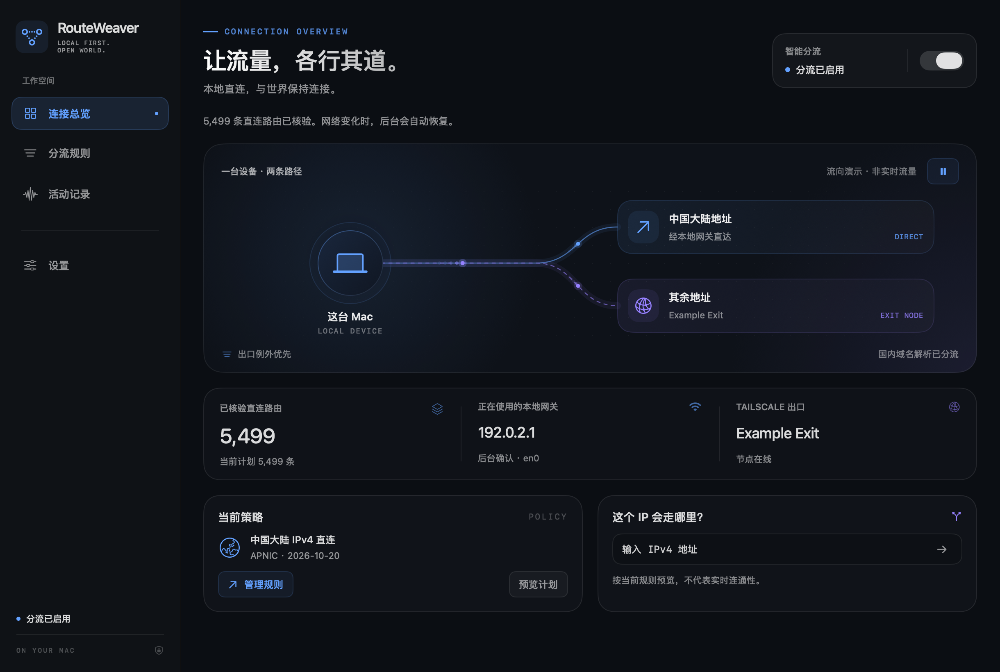
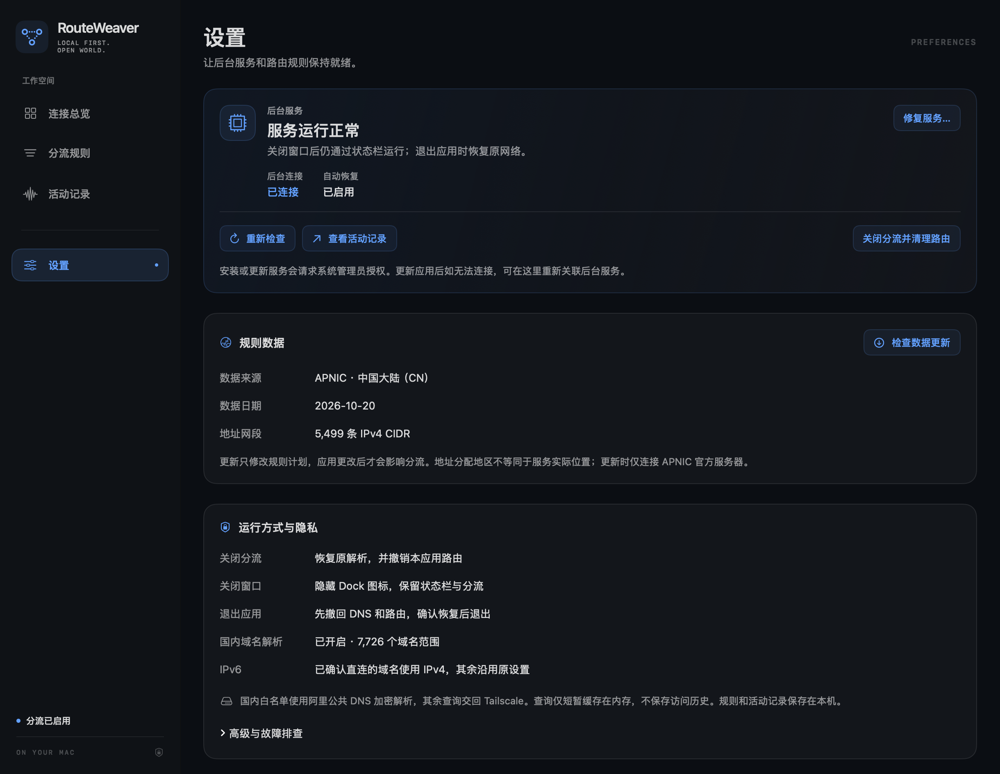

<div align="center">


# RouteWeaver

**让国内连接直达，让其余流量继续走 Tailscale。**

为使用 Tailscale exit node 的 Mac 提供 IPv4 分流、规则管理与菜单栏速率显示。

<p>
  <a href="#快速开始"></a>
  <a href="#快速开始"></a>
  <a href="https://github.com/Hmmzzz/RouteWeaver/releases/tag/v1.0.3"></a>
  <a href="THIRD_PARTY_NOTICES.md"></a>
</p>

<p>
  <a href="docs/DEVELOPMENT.md"></a>
  <a href="docs/DEVELOPMENT.md"></a>
  <a href="docs/SECURITY.md"></a>
  <a href="https://tailscale.com/"></a>
</p>

<p>
  <a href="#快速开始">快速开始</a> ·
  <a href="docs/USAGE.md">使用指南</a> ·
  <a href="https://github.com/Hmmzzz/RouteWeaver/issues">反馈问题</a>
</p>

<sub>下载使用无需 Swift 工具链。当前发布包采用 ad-hoc 签名，尚未进行 Apple 公证。</sub>

</div>

<br>

<p align="center">
  
</p>

<p align="center"><sub>界面使用示例数据展示，不包含真实节点、私人网络或访问记录。</sub></p>

## 一台 Mac，两条路径

- **国内直连，保留出口** — 内置中国大陆 IPv4 网段经本地 Wi-Fi / 以太网网关直连，其余 IPv4 流量继续沿用 Tailscale exit node。
- **规则自己掌握** — 添加自定义直连与出口例外，导入、导出规则，并查询一个 IP 会走哪条路径。
- **状态随时可见** — 菜单栏与弹窗显示两路速率，连接总览呈现路由、网关和出口状态。
- **网络变化自动恢复** — 跟随网络变化恢复分流；正常退出时撤回本应用的 DNS 设置与路由。

国内域名白名单可使用阿里公共 DNS 解析，其他查询沿用原有解析路径。具体范围见 [安全与隐私](docs/SECURITY.md) 和 [数据来源](docs/DATA.md)。

<details>
<summary><strong>查看设置界面</strong> · 后台服务、运行方式与隐私</summary>

<p align="center">
  
</p>

</details>

## 快速开始

**需要：Apple Silicon Mac、macOS 14 或更新版本，以及已连接 exit node 的 [Tailscale](https://tailscale.com/)。**

1. 从 [Releases](https://github.com/Hmmzzz/RouteWeaver/releases/latest) 下载 App ZIP，解压后将 `RouteWeaver.app` 放入“应用程序”。
2. 打开 RouteWeaver，确认 Tailscale 出口和本地网关已识别。
3. 首次开启分流时，完成后台服务的管理员授权。以后使用同一构建会复用授权。

> 当前发布包仅含 **arm64**，采用 ad-hoc 签名，未做 Developer ID 签名或 Apple 公证。首次打开、更新授权及其他常见问题见 [使用指南](docs/USAGE.md)。

<details>
<summary><strong>从源码构建</strong> · 需要 Xcode 26+（Swift 6.2+）</summary>

```sh
git clone https://github.com/Hmmzzz/RouteWeaver.git
cd RouteWeaver
./script/build_and_run.sh --build-only
open dist/RouteWeaver.app
```

无需第三方 Swift 包。构建后的 App 与 ZIP 位于 `dist/`；脚本按本机架构构建，Intel Mac 的源码构建与运行尚未验证。

环境要求、测试命令与项目结构见 [开发指南](docs/DEVELOPMENT.md)。

</details>

## 使用时需要知道

| 操作 | 行为 |
| :--- | :--- |
| 关闭窗口 | 保留菜单栏与分流，继续运行。 |
| 关闭分流 | 撤回本应用的 DNS 设置和路由。 |
| 退出应用 | 等待网络清理完成后退出。 |
| 完整卸载 | 从设置打开卸载工具，先恢复网络，再清理服务和本机数据。 |

RouteWeaver 只管理 **IPv4 分流**，不提供按应用分流；IPv6 仍由系统和 Tailscale 管理。它需要已有的 Tailscale exit node 连接，不提供出口节点，也不是防泄漏工具。

卸载步骤与保留的数据范围见 [完整卸载与清理](docs/USAGE.md#完整卸载与清理)。

## 文档与开发

| 我想了解… | 从这里开始 |
| :--- | :--- |
| 安装、授权、日常使用与卸载 | [使用指南](docs/USAGE.md) |
| 管理员权限、DNS 与隐私边界 | [安全与隐私](docs/SECURITY.md) |
| IP 网段、域名名单与重建方法 | [数据来源](docs/DATA.md) |
| 构建、测试与项目结构 | [开发指南](docs/DEVELOPMENT.md) |
| 提交代码、问题反馈与审阅约定 | [贡献指南](CONTRIBUTING.md) |
| 私密报告漏洞与安全维护范围 | [漏洞报告](SECURITY.md) |
| 第三方代码来源与许可 | [代码来源](docs/PROVENANCE.md) |
| 打包与发布检查 | [发布指南](docs/RELEASING.md) |

欢迎通过 [Issues](https://github.com/Hmmzzz/RouteWeaver/issues) 反馈普通使用问题。提交日志或截图前，请按 [脱敏说明](docs/SECURITY.md#本地资料与问题反馈) 移除私人信息。

安全漏洞请使用 [漏洞报告流程](SECURITY.md)，避免在公开问题中披露细节。

## 许可与致谢

原创代码采用 [MIT License](LICENSE)；路由统计 ABI 头文件 `Sources/CRouteStatistics/NetworkStatisticsABI.h` 采用 [APSL 2.0](LICENSES/APSL-2.0.txt)，第三方数据保留各自许可。当前打包脚本会随 App 附上该 APSL 组件的修改源码与许可证，范围及路径见 [第三方说明](THIRD_PARTY_NOTICES.md)。

分流思路与 `PF_ROUTE` 批量路由方案参考了 **[leolovenet/tailscale-routes](https://github.com/leolovenet/tailscale-routes)**，特别感谢原作者。

数据来源包括 APNIC 与 domain-list-community；设计与技术参考及各自使用范围见 [第三方说明](THIRD_PARTY_NOTICES.md)。
